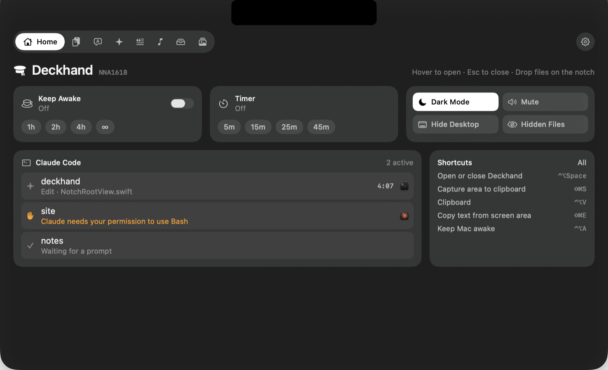
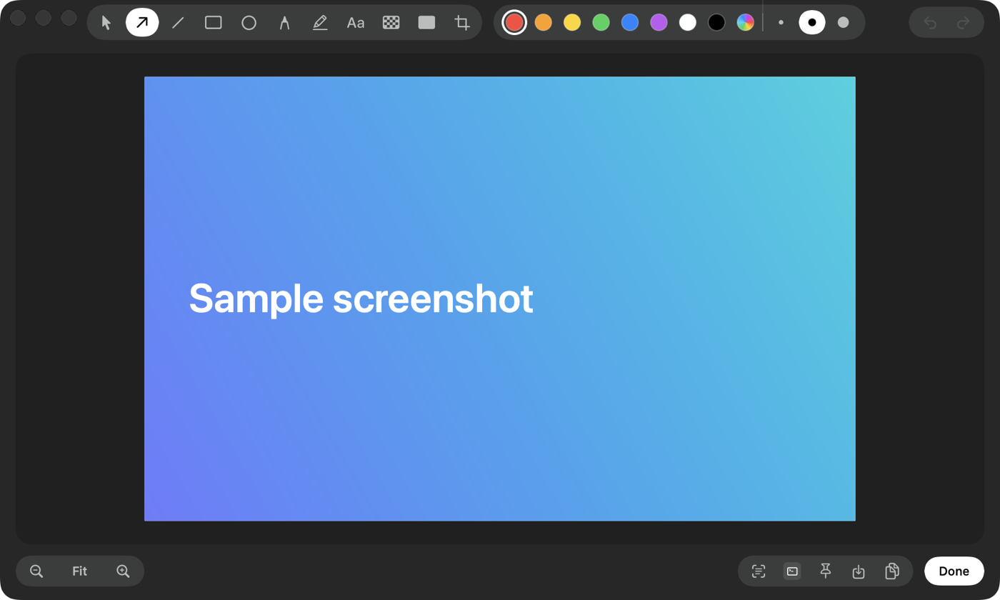
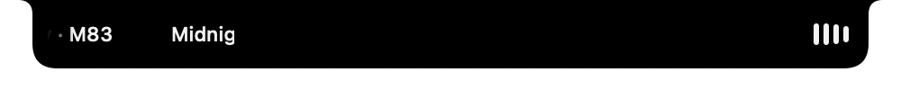
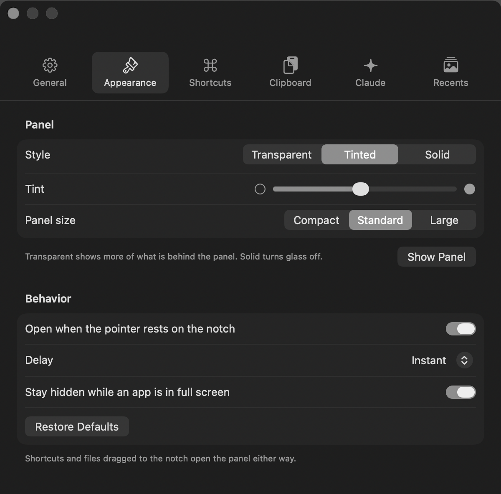

<p align="center">
  <picture>
    <source media="(prefers-color-scheme: dark)" srcset="Resources/Brand/mark-white.svg">
    
  </picture>
</p>

<p align="center"><sub>NNA1618</sub></p>

<h1 align="center">Deckhand</h1>

<p align="center">Your MacBook notch, put to work.</p>

<p align="center"><a href="README.ru.md">Русский</a></p>

---

Deckhand lives in the notch. Hover over it and a dark glass panel grows out of the cutout with your clipboard, a translator, Claude, saved prompts, music controls, a file shelf and recent media. Move away and it disappears.

It is a native macOS app written in Swift and SwiftUI. No Electron, no account, no telemetry.

<p align="center"></p>

## Features

**Clipboard**
- History of text, images and files with search and pinning.
- Click to copy, double-click to paste straight into the app you were using.
- Type to search, pick with the arrows, press Return to paste. `⌘1`–`⌘9` paste one of the first nine.
- Passwords copied from password managers, including Apple Passwords, paste normally but stay out of the history.

**Screenshots**
- `⇧⌘S` captures an area straight to the clipboard: no file on the desktop, no floating thumbnail.
- `⇧⌘E` copies the text from a screen area, recognized on device.
- Click an image in the clipboard to open the editor: crop, pen, highlighter, rectangles, ellipses, lines, arrows, text, and blur for anything private. Any color.
- Ask Claude about an image right from the editor, or pin it on top of other windows.

<p align="center"></p>

**Claude Code in the notch**
- See every Claude Code session at a glance: which project it works on, the tool it runs right now and for how long. Works for Claude Code in Terminal, editors and the Claude app.
- While Claude works, a sparkle and the time spent show around the closed notch. When it needs a permission or an answer, the notch shows a raised hand and plays a sound. When a task is done, you get a short notice.
- Click a session to bring its window to the front. Connect it in Settings → Claude with one click: Deckhand adds a small hook to `~/.claude/settings.json` and keeps a backup.

<p align="center"></p>

**Mac conveniences**
- **Keep Awake.** Stops the Mac from sleeping for an hour, two, four or until you turn it off, like Amphetamine. Toggle it with `⌃⌥A`, from the Home tab or the menu bar. A cup and the time left show around the closed notch.
- **Timer.** 5, 15, 25 or 45 minutes from the Home tab, with pause and +1 minute. The time left shows around the closed notch, and a chime plays at the end.
- **Quick toggles.** Dark Mode, Mute, Hide Desktop icons (handy before a screen share) and Hidden Files in Finder, one click each.
- **Battery.** Plugging in the charger shows the level in the notch, and so does the battery dropping to 20% and 10%.
- **Appearance.** Transparent or tinted Liquid Glass, or a solid panel, with a tint slider and three panel sizes. Hovering can be delayed or turned off, and the panel stays closed while an app is in full screen.

<p align="center"></p>

**Everything else**
- **Translate.** On-device translation through Apple's Translation framework. Detects the language and picks the direction.
- **Claude.** One-click actions for text: rewrite, shorten, fix grammar, explain, review code, improve a prompt, translate to English. They run through Claude Code with your Claude plan, so no API key is needed. An API key in the Keychain still works if you prefer it. Chat opens the Claude app.
- **Prompts.** A searchable library of prompts by category. Click to copy.
- **Music.** Play, pause and skip for any player. While music plays, the track scrolls around the closed notch.
- **Shelf.** Drop files on the notch to keep them at hand, then drag them out anywhere or send them with AirDrop.
- **Recents.** Fresh images and videos from folders you choose, handy for AI generations you just downloaded.
- **Color picker.** `⌃⌥C` copies the hex value of any pixel on screen.

<p align="center"></p>

English and Russian. Pick the language in Settings → General, or let it follow macOS.

## Requirements

- A MacBook with a notch (Apple silicon)
- macOS 15 Sequoia or later. Liquid Glass appears on macOS 26 Tahoe.

## Install

1. Download `Deckhand.zip` from [Releases](https://github.com/NNA1618/deckhand/releases) and move `Deckhand.app` to Applications.
2. Deckhand is not notarized yet, so macOS blocks the first launch. Run this once in Terminal:

   ```bash
   xattr -dr com.apple.quarantine /Applications/Deckhand.app
   ```

3. Open Deckhand. Its icon appears in the menu bar.

## Shortcuts

| Action | Default |
|---|---|
| Open or close Deckhand | `⌃⌥ Space` |
| Capture area to clipboard | `⇧⌘S` |
| Copy text from screen area | `⇧⌘E` |
| Pick a color from screen | `⌃⌥C` |
| Keep Mac awake | `⌃⌥A` |
| Clipboard | `⌃⌥V` |
| Translate | `⌃⌥T` |
| Claude | `⌃⌥K` |
| Prompts | `⌃⌥P` |
| Music | `⌃⌥M` |
| Shelf | `⌃⌥F` |
| Recents | `⌃⌥H` |

Every shortcut can be changed in Settings → Shortcuts: click it and press new keys.

<p align="center"></p>

## Privacy

Everything stays on your Mac. The clipboard history lives in `~/Library/Application Support/Deckhand`. Deckhand itself never talks to the network. Claude actions go through your local Claude Code, or to the Anthropic API if you chose an API key. The Claude Code hook only writes event files to that folder; Deckhand reads the project folder name and the tool name and never stores prompts or code.

Permissions macOS may ask for:

- **Screen Recording**, for screenshots and text capture.
- **Accessibility**, only to paste into another app and to tell when the app in front is in full screen.
- **Automation**, to read the current track from Music, Spotify or a browser, and for the Dark Mode toggle.

## Build from source

You only need the Xcode Command Line Tools, not the full Xcode.

```bash
git clone https://github.com/NNA1618/deckhand.git
cd deckhand
./scripts/setup-signing.sh      # once: a local signing identity so permissions survive rebuilds
./scripts/bundle.sh release     # builds, installs to /Applications and launches
```

See [CONTRIBUTING.md](CONTRIBUTING.md) for checks and screenshots.

## License

[MIT](LICENSE) © 2026 NNA1618
