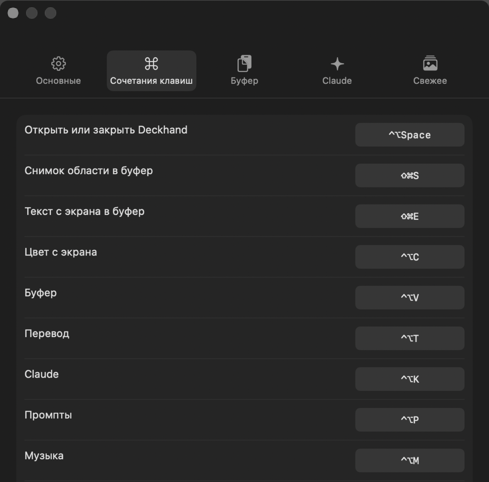

<p align="center">
  <picture>
    <source media="(prefers-color-scheme: dark)" srcset="Resources/Brand/mark-white.svg">
    
  </picture>
</p>

<p align="center"><sub>NNA1618</sub></p>

<h1 align="center">Deckhand</h1>

<p align="center">Your MacBook notch, put to work.</p>

<p align="center"><a href="README.ru.md">Русский</a></p>

---

Deckhand lives in the notch. Hover over it and a dark glass panel grows out of the cutout with your clipboard, a translator, Claude, saved prompts, music controls, a file shelf and recent media. Move away and it disappears.

It is a native macOS app written in Swift and SwiftUI. No Electron, no account, no telemetry.

<p align="center"></p>

## Features

**Clipboard**
- History of text, images and files with search and pinning.
- Click to copy, double-click to paste straight into the app you were using.
- Passwords copied from password managers paste normally but stay out of the history.

**Screenshots**
- `⇧⌘S` captures an area straight to the clipboard: no file on the desktop, no floating thumbnail.
- `⇧⌘E` copies the text from a screen area, recognized on device.
- Click an image in the clipboard to open the editor: crop, pen, highlighter, rectangles, ellipses, lines, arrows, text, and blur for anything private. Any color.
- Ask Claude about an image right from the editor, or pin it on top of other windows.

<p align="center"></p>

**Everything else**
- **Translate.** On-device translation through Apple's Translation framework. Detects the language and picks the direction.
- **Claude.** One-click presets for text (rewrite, shorten, fix grammar, explain, review code, improve a prompt) and a quick chat. Uses your own Anthropic API key, stored in the Keychain.
- **Prompts.** A searchable library of prompts by category. Click to copy.
- **Music.** Play, pause and skip for any player. While music plays, the track scrolls around the closed notch.
- **Shelf.** Drop files on the notch to keep them at hand, then drag them out anywhere or send them with AirDrop.
- **Recents.** Fresh images and videos from folders you choose, handy for AI generations you just downloaded.
- **Color picker.** `⌃⌥C` copies the hex value of any pixel on screen.

<p align="center"></p>

English and Russian. The app follows your system language.

## Requirements

- A MacBook with a notch (Apple silicon)
- macOS 15 Sequoia or later. Liquid Glass appears on macOS 26 Tahoe.

## Install

1. Download `Deckhand.zip` from [Releases](https://github.com/NNA1618/deckhand/releases) and move `Deckhand.app` to Applications.
2. Deckhand is not notarized yet, so macOS blocks the first launch. Run this once in Terminal:

   ```bash
   xattr -dr com.apple.quarantine /Applications/Deckhand.app
   ```

3. Open Deckhand. Its icon appears in the menu bar.

## Shortcuts

| Action | Default |
|---|---|
| Open or close Deckhand | `⌃⌥ Space` |
| Capture area to clipboard | `⇧⌘S` |
| Copy text from screen area | `⇧⌘E` |
| Pick a color from screen | `⌃⌥C` |
| Clipboard | `⌃⌥V` |
| Translate | `⌃⌥T` |
| Claude | `⌃⌥K` |
| Prompts | `⌃⌥P` |
| Music | `⌃⌥M` |
| Shelf | `⌃⌥F` |
| Recents | `⌃⌥H` |

Every shortcut can be changed in Settings → Shortcuts: click it and press new keys.

<p align="center"></p>

## Privacy

Everything stays on your Mac. The clipboard history lives in `~/Library/Application Support/Deckhand`. Deckhand talks to the network only when you use Claude, and then only to the Anthropic API with your key.

Permissions macOS may ask for:

- **Screen Recording**, for screenshots and text capture.
- **Accessibility**, only to paste into another app.
- **Automation**, to read the current track from Music, Spotify or a browser.

## Build from source

You only need the Xcode Command Line Tools, not the full Xcode.

```bash
git clone https://github.com/NNA1618/deckhand.git
cd deckhand
./scripts/setup-signing.sh      # once: a local signing identity so permissions survive rebuilds
./scripts/bundle.sh release     # builds, installs to /Applications and launches
```

See [CONTRIBUTING.md](CONTRIBUTING.md) for checks and screenshots.

## License

[MIT](LICENSE) © 2026 NNA1618
