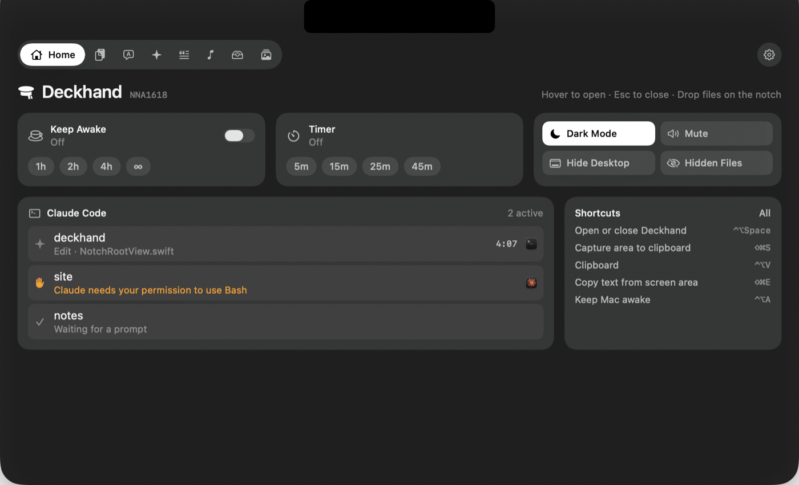
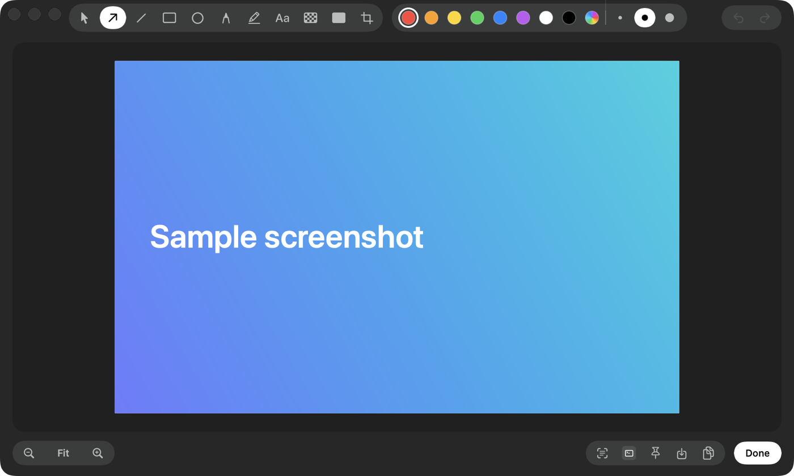
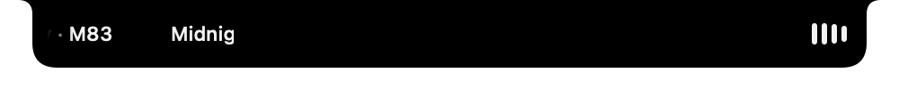
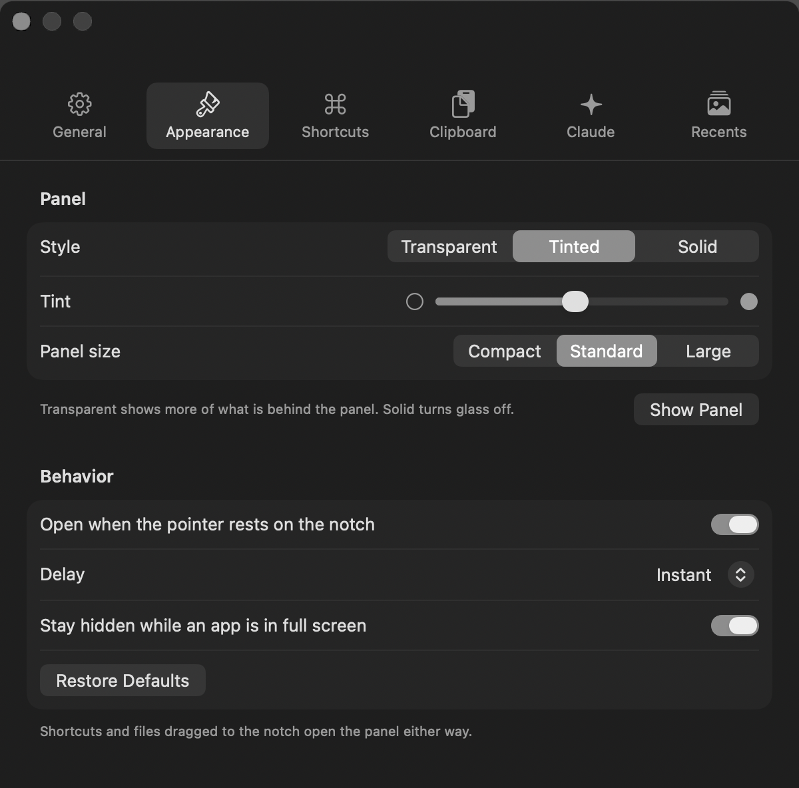

<p align="center">
  <picture>
    <source media="(prefers-color-scheme: dark)" srcset="Resources/Brand/mark-white.svg">
    
  </picture>
</p>

<p align="center"><sub>NNA1618</sub></p>

<h1 align="center">Deckhand</h1>

<p align="center">Чёлка вашего MacBook, которая работает.</p>

<p align="center"><a href="README.md">English</a></p>

---

Deckhand живёт в чёлке. Задержите на ней указатель, и из выреза вырастет стеклянная панель: буфер обмена, переводчик, Claude, сохранённые промпты, музыка, полка файлов и недавние медиа. Уведите указатель, и панель исчезнет. Пока панель закрыта, чёлка показывает то, что важно прямо сейчас: работу Claude Code, таймер, играющий трек.

Это нативное приложение для macOS на Swift и SwiftUI. Без Electron, без аккаунта, без телеметрии.

<p align="center"></p>

## Возможности

**Чёлка**
- Открывается, когда указатель задерживается на вырезе, а не когда пролетает мимо к строке меню. Зона наведения, задержка, открытие по щелчку или только сочетанием клавиш и задержка закрытия настраиваются.
- При открытии наведением не забирает клавиатуру. Над полноэкранными приложениями может не открываться.
- Уведомления о снимках, таймере, батарее и Claude появляются под чёлкой. Те, что требуют внимания, остаются, пока вы их не увидите.
- Работает на внешних мониторах и Mac без выреза: там появляется виртуальная чёлка.

**Claude Code в чёлке**
- Все сессии Claude Code перед глазами: проект, что сейчас делается и сколько уже идёт задача. Работает для Claude Code в Терминале, редакторах и приложении Claude.
- Пока Claude работает, у закрытой чёлки видны его иконка и время. Когда нужно разрешение или ответ, чёлка показывает поднятую руку и звучит сигнал. Когда задача готова, приходит короткое уведомление. Запросы разрешений можно одобрять прямо из чёлки.
- Щелчок по сессии выводит её вперёд: нужную вкладку в Терминале и iTerm, окно проекта в VS Code и Cursor.
- Подключается одной кнопкой в Настройки → Claude. Deckhand добавляет свои записи в `~/.claude/settings.json` (или в папку из `CLAUDE_CONFIG_DIR`), больше ничего в файле не меняет и сохраняет рядом копию оригинала.

<p align="center"></p>

**Codex в чёлке**
- Сессии OpenAI Codex видны так же, со значком Codex: у закрытой чёлки, на главной, в списке сессий и в уведомлениях. Работает для Codex CLI, редакторов и приложения ChatGPT (бывшее приложение Codex), начиная с Codex 0.124.
- Подключается в Настройки → Codex. Deckhand добавляет свои хуки после ваших в `~/.codex/hooks.json` (или в папку из `CODEX_HOME`), больше ничего в файле не меняет и сохраняет рядом копию оригинала. Хуки, которые Codex создал не сам, он запускает только после вашего одобрения: введите `/hooks` в CLI или откройте Review hooks в приложении ChatGPT, затем начните новую сессию.
- Deckhand хранит только id сессии, папку проекта, событие и название инструмента. Промпты, код и вывод не покидают Codex, а файлы сессий Codex Deckhand не читает.
- Одобрение из чёлки по умолчанию выключено. Когда оно включено, «Разрешить» и «Отклонить» отвечают на один запрос; «Разрешать всегда» нет, а если не ответить вовремя, Codex покажет свой запрос.

**Буфер обмена**
- История текста, ссылок, изображений и файлов: поиск на любом языке, фильтры, закрепление. Повторно скопированное поднимается наверх.
- Начните печатать для поиска, выбирайте стрелками. Return вставляет в приложение, где вы работали, `⌥Return` — без форматирования, `⌘1`–`⌘9` — одну из первых девяти записей, пробел открывает просмотр.
- Историю можно поставить на паузу или очистить. Пароли из менеджеров паролей, включая «Пароли» Apple, вставляются как обычно, но в историю не попадают.

**Снимки и текст**
- Снимок области, окна или всего экрана сразу в буфер обмена, с открытием в редакторе или сохранением.
- Текст с области экрана или с любого изображения, распознаётся на самом Mac. QR-коды и штрихкоды копируются содержимым.
- Редактор: обрезка, перо, маркер, фигуры, стрелки, текст, размытие и закрашивание, масштаб и вопрос Claude об изображении.

<p align="center"></p>

**Перевод**
- Перевод на самом Mac через Apple Translation, прямо по мере набора. Язык определяется сам, или выберите оба языка; избранные языки — в один клик.
- Перевод можно скопировать, вставить в приложение, где вы работали, или прослушать.
- Выделите текст в любом приложении и нажмите `⌃⌥⇧T`, чтобы перевести его.

**Удобства для Mac**
- **Не спать.** Не даёт Mac уснуть на час, два, четыре или пока не выключите, как Amphetamine, и может выключиться сам при низком заряде. Пока режим включён, у закрытой чёлки видны чашка и оставшееся время.
- **Таймер.** Готовые варианты или любая длительность, пауза и +1 минута, сигнал может звучать, пока вы его не закроете.
- **Быстрые тумблеры.** Тёмный режим, выключение звука, скрытие значков на рабочем столе (удобно перед показом экрана) и скрытые файлы в Finder, каждый в один клик.
- **Батарея.** При подключении зарядки чёлка показывает заряд. И ещё раз, когда батарея падает до 20% и 10%.

<p align="center"></p>

**Остальное**
- **Claude.** Действия с текстом в один клик: переписать, сократить, исправить ошибки, объяснить, проверить код, улучшить промпт. Работают через Claude Code по вашей подписке Claude, ключ API не нужен; ключ API в связке ключей тоже подойдёт. Чат открывается в приложении Claude.
- **Промпты.** Библиотека промптов по категориям с поиском, переменными `{{вида}}`, которые заполняются перед вставкой, импортом и экспортом.
- **Музыка.** Знает, что на самом деле играет в «Музыке», Spotify и вкладках браузера, показывает трек у чёлки и прячет его на паузе.
- **Полка.** Перетащите файлы на чёлку, чтобы держать их под рукой, потом вытаскивайте куда угодно, делитесь или отправляйте по AirDrop. Перемещённые файлы не теряются.
- **Недавние.** Новые изображения и видео из выбранных папок, удобно для только что скачанных генераций.
- **Пипетка.** Копирует цвет любого пикселя на экране в hex, rgb, hsl или SwiftUI.

<p align="center"></p>

Английский и русский. Язык выбирается в Настройки → Основные, или как в macOS.

## Требования

- Mac на Apple silicon. Лучше всего Deckhand чувствует себя в чёлке; на других экранах появляется виртуальная чёлка.
- macOS 15 Sequoia или новее. Liquid Glass появляется на macOS 26 Tahoe.

## Установка

1. Скачайте `Deckhand.zip` в [Releases](https://github.com/NNA1618/deckhand/releases) и перенесите `Deckhand.app` в «Программы».
2. Deckhand пока не нотаризован, поэтому macOS заблокирует первый запуск. Один раз выполните в Терминале:

   ```bash
   xattr -dr com.apple.quarantine /Applications/Deckhand.app
   ```

3. Откройте Deckhand. Его значок появится в строке меню.

## Сочетания клавиш

Все сочетания начинаются с `⌃⌥⇧`, чтобы не мешать переключению раскладки, «Сохранить как» в других приложениях и менеджерам окон вроде Rectangle.

| Действие | По умолчанию |
|---|---|
| Открыть или закрыть Deckhand | `⌃⌥⇧D` |
| Снять область в буфер обмена | `⌃⌥⇧S` |
| Скопировать текст с экрана | `⌃⌥⇧E` |
| Взять цвет с экрана | `⌃⌥⇧C` |
| Не давать Mac уснуть | `⌃⌥⇧A` |
| Перевести выделенный текст | `⌃⌥⇧T` |
| Буфер обмена | `⌃⌥⇧V` |
| Перевод | `⌃⌥⇧L` |
| Claude | `⌃⌥⇧K` |
| Промпты | `⌃⌥⇧P` |
| Музыка | `⌃⌥⇧M` |
| Полка | `⌃⌥⇧F` |
| Недавние | `⌃⌥⇧H` |

Любое сочетание меняется в Настройки → Сочетания клавиш. Deckhand предупредит, если сочетание уже занято macOS или другим приложением. У снимка окна, всего экрана, снимка с задержкой и «снять и изменить» сочетаний по умолчанию нет — задайте их, если пользуетесь.

<p align="center"></p>

## Приватность

Всё остаётся на вашем Mac. История буфера обмена лежит в `~/Library/Application Support/Deckhand`. Сам Deckhand в сеть не выходит. Действия Claude идут через ваш локальный Claude Code или к API Anthropic, если вы выбрали ключ API. Хук Claude Code записывает в эту папку маленькие файлы событий, только пока Deckhand запущен, и Deckhand удаляет каждый сразу после чтения. В файле есть только id сессии, событие, папка проекта, инструмент с именем файла или первым словом команды и приложение, в котором идёт сессия. Промпты, код, команды целиком, вывод инструментов и ответы Claude на диск не попадают.

Какие разрешения может попросить macOS (все с состоянием в Настройки → Конфиденциальность):

- **Запись экрана** — для снимков и распознавания текста.
- **Универсальный доступ** — чтобы вставлять в другое приложение, брать выделенный текст для перевода и пользоваться медиаклавишами.
- **Автоматизация** — чтобы узнать трек в «Музыке», Spotify или вкладке браузера, переключить тёмный режим и выбрать вкладку Терминала или iTerm при щелчке по сессии Claude.

## Сборка из исходников

Нужны только Command Line Tools от Xcode, полный Xcode не нужен.

```bash
git clone https://github.com/NNA1618/deckhand.git
cd deckhand
./scripts/setup-signing.sh      # один раз: локальная подпись, чтобы разрешения не слетали после сборки
./scripts/bundle.sh release     # собирает, ставит в /Applications и запускает
```

Подробнее в [CONTRIBUTING.md](CONTRIBUTING.md).

## Лицензия

[MIT](LICENSE) © 2026 NNA1618
