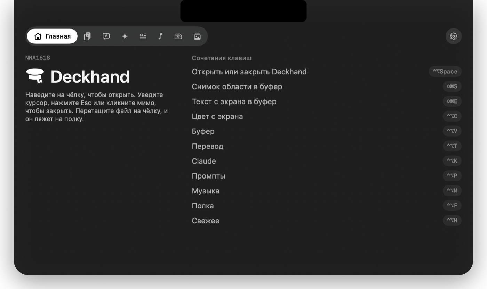
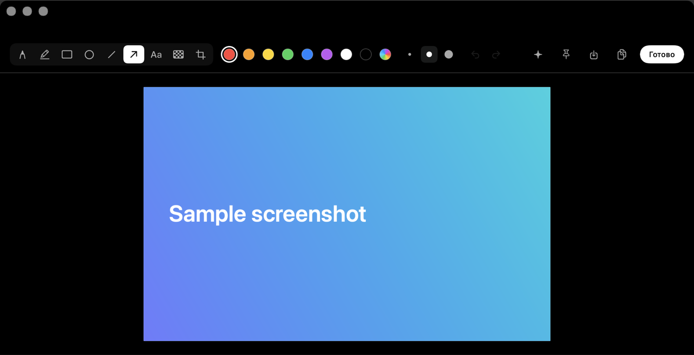
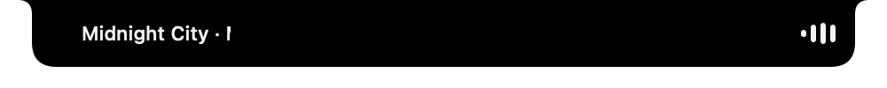

<p align="center">
  <picture>
    <source media="(prefers-color-scheme: dark)" srcset="Resources/Brand/mark-white.svg">
    
  </picture>
</p>

<p align="center"><sub>NNA1618</sub></p>

<h1 align="center">Deckhand</h1>

<p align="center">Чёлка вашего MacBook, которая работает.</p>

<p align="center"><a href="README.md">English</a></p>

---

Deckhand живёт в чёлке. Наведите на неё курсор, и из выреза вырастет тёмная стеклянная панель: буфер обмена, переводчик, Claude, сохранённые промпты, музыка, полка файлов и свежие медиа. Уведите курсор, и панель исчезнет.

Это нативное приложение для macOS на Swift и SwiftUI. Без Electron, без аккаунта, без телеметрии.

<p align="center"></p>

## Возможности

**Буфер обмена**
- История текста, картинок и файлов с поиском и закреплением.
- Клик копирует, двойной клик сразу вставляет в приложение, где вы работали.
- Пароли из менеджеров паролей вставляются как обычно, но в историю не попадают.

**Скриншоты**
- `⇧⌘S` снимает область сразу в буфер: без файла на рабочем столе и без превью в углу.
- `⇧⌘E` копирует текст с выбранной области экрана. Распознавание идёт на самом Mac.
- Клик по картинке в буфере открывает редактор: обрезка, карандаш, маркер, прямоугольники, эллипсы, линии, стрелки, текст и размытие для всего личного. Любой цвет.
- Прямо из редактора можно спросить Claude про картинку или закрепить её поверх окон.

<p align="center"></p>

**Остальное**
- **Перевод.** На устройстве, через Translation от Apple. Сам определяет язык и направление.
- **Claude.** Пресеты для текста в один клик (переписать, сократить, исправить ошибки, объяснить, ревью кода, улучшить промпт) и быстрый чат. Работает с вашим ключом Anthropic API, ключ хранится в связке ключей.
- **Промпты.** Библиотека промптов по категориям с поиском. Клик копирует.
- **Музыка.** Воспроизведение и переключение для любого плеера. Пока играет музыка, название трека бежит вокруг закрытой чёлки.
- **Полка.** Перетащите файлы на чёлку, чтобы держать их под рукой, потом вытаскивайте куда угодно или отправляйте по AirDrop.
- **Свежее.** Новые картинки и видео из выбранных папок, удобно для только что скачанных генераций.
- **Пипетка.** `⌃⌥C` копирует hex-код цвета любого пикселя на экране.

<p align="center"></p>

Английский и русский. Язык приложения такой же, как в системе.

## Требования

- MacBook с чёлкой (Apple silicon)
- macOS 15 Sequoia или новее. Liquid Glass появляется на macOS 26 Tahoe.

## Установка

1. Скачайте `Deckhand.zip` в [Releases](https://github.com/NNA1618/deckhand/releases) и перенесите `Deckhand.app` в «Программы».
2. Deckhand пока не нотаризован, поэтому macOS заблокирует первый запуск. Один раз выполните в Терминале:

   ```bash
   xattr -dr com.apple.quarantine /Applications/Deckhand.app
   ```

3. Откройте Deckhand. Его значок появится в строке меню.

## Сочетания клавиш

| Действие | По умолчанию |
|---|---|
| Открыть или закрыть Deckhand | `⌃⌥ Space` |
| Снимок области в буфер | `⇧⌘S` |
| Текст с экрана в буфер | `⇧⌘E` |
| Цвет с экрана | `⌃⌥C` |
| Буфер | `⌃⌥V` |
| Перевод | `⌃⌥T` |
| Claude | `⌃⌥K` |
| Промпты | `⌃⌥P` |
| Музыка | `⌃⌥M` |
| Полка | `⌃⌥F` |
| Свежее | `⌃⌥H` |

Любое сочетание меняется в Настройки → Сочетания клавиш: нажмите на него и введите новое.

## Приватность

Всё остаётся на вашем Mac. История буфера лежит в `~/Library/Application Support/Deckhand`. В сеть Deckhand выходит, только когда вы пользуетесь Claude, и только к API Anthropic с вашим ключом.

Какие разрешения может попросить macOS:

- **Запись экрана**, для скриншотов и распознавания текста.
- **Универсальный доступ**, только чтобы вставлять в другое приложение.
- **Автоматизация**, чтобы узнать текущий трек в Музыке, Spotify или браузере.

## Сборка из исходников

Нужны только Command Line Tools от Xcode, полный Xcode не нужен.

```bash
git clone https://github.com/NNA1618/deckhand.git
cd deckhand
./scripts/setup-signing.sh      # один раз: локальная подпись, чтобы разрешения не слетали после сборки
./scripts/bundle.sh release     # собирает, ставит в /Applications и запускает
```

Подробнее в [CONTRIBUTING.md](CONTRIBUTING.md).

## Лицензия

[MIT](LICENSE) © 2026 NNA1618
